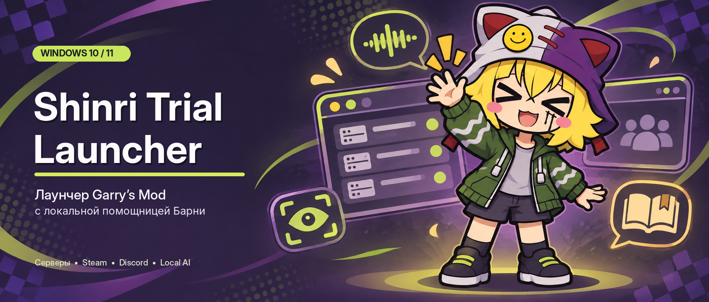
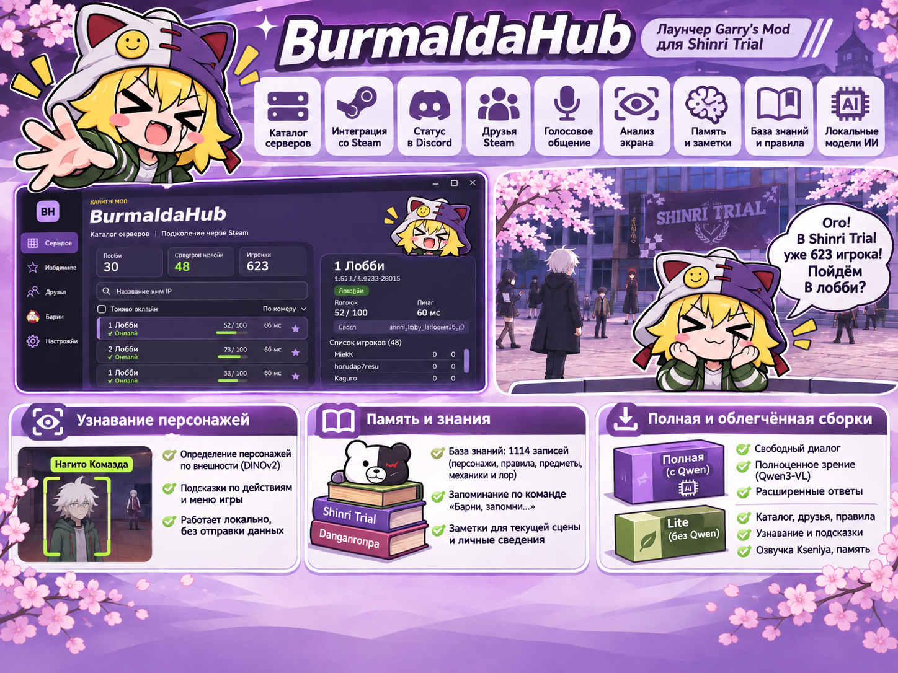
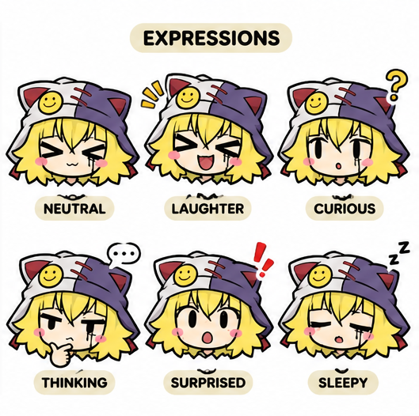

# Shinri Trial Launcher



**Shinri Trial Launcher** — русскоязычный лаунчер для **Garry’s Mod / Shinri Trial** на Windows с каталогом серверов, подключением через Steam, отображением игровой активности в Discord и локальной игровой помощницей **Барни**.

Барни может реагировать на события в игровом интерфейсе, распознавать русскую речь, озвучивать ответы, обращаться к справочнику Shinri Trial и Danganronpa, а при установленных моделях Qwen — отвечать на свободные вопросы и анализировать изображение игры. Для базовых функций лаунчера облачный ИИ и API-ключ не нужны.

> **О версиях.** Проект документирован в нескольких сборках и пакетах обновлений (`Barni-Talk`, `Barni-Guidebook`, `Barni-Friends`, `Barni-Recognition`, `Barni-Continuous`, `Barni-Settings`, `Lite` и др.). Наличие функции зависит от установленной сборки и компонентов. Имена папок в документации обозначают этапы разработки, **а не гарантированную последовательность совместимых обновлений**. Ниже сведены возможности, описанные в документации по состоянию на **16 ноября 2026 года**.

## Содержание

- [Возможности](#возможности)
- [Системные требования](#системные-требования)
- [Установка и первый запуск](#установка-и-первый-запуск)
- [Настройка Барни](#настройка-барни)
- [Steam, Discord и друзья](#steam-discord-и-друзья)
- [Локальные модели и память](#локальные-модели-и-память)
- [Сборка из исходников](#сборка-из-исходников)
- [Проверки и ограничения](#проверки-и-ограничения)
- [Структура проекта](#структура-проекта)
- [Документация и лицензии](#документация-и-лицензии)

## Возможности



*Художественная визуализация функций: элементы интерфейса и игровая сцена на изображении не являются реальными скриншотами приложения.*

### Лаунчер и каталог

- Каталог **30 публичных лобби** Shinri Trial; информация об онлайне также собирается с игровых серверов (в исходной конфигурации — **268 уникальных адресов** с учётом пересечений списков).
- Поиск лобби по номеру, названию или адресу, сортировка по номеру, пингу и количеству игроков, избранное.
- Асинхронный UDP-опрос Source-серверов (`A2S_INFO`, `A2S_PLAYER`), список игроков и автоматическое обновление.
- Подключение к выбранному серверу через `steam://connect/IP:PORT`.
- Поиск своей текущей сессии и предложение вернуться в игру после отключения — при наличии надёжных данных Steam, локальной Lua-интеграции или совпадения ника.
- Настраиваемый интерфейс: цветовые темы, прозрачность фона, пользовательское фоновое изображение.
- **Деморежим** без Steam и сетевого опроса.

### Помощница Барни

<p align="center"></p>

- Отдельный раздел **«Барни»** в боковом меню в сборках с обновлением интерфейса. Общие параметры лаунчера остаются в **«Настройках»**.
- Маскот поверх активного окна Garry’s Mod: девять готовых позиций, ручные координаты и настройка области перемещения.
- Сценарные реакции на устойчивые изменения игрового интерфейса: инвентарь, колесо взаимодействий, предметы, некоторые сообщения о действиях, события лобби и матча.
- Локальное распознавание речи **Vosk**: отдельно — игровой звук и, с явного разрешения, микрофон владельца.
- Озвучка голосом **Kseniya (Silero)** или доступным голосом Windows; выбор устройств вывода.
- Ручная передача последней озвученной реплики в игровой голосовой чат через виртуальное аудиоустройство; автоматическая передача — отдельная настройка.
- Ответы на вопросы о правилах, персонажах, лоре и механиках; подтверждаемые заметки и изолированная память RP-сцены.
- При наличии соответствующих модулей: локальная Qwen для свободного диалога, **Qwen3-VL** для анализа кадра, **YOLOX + DINOv2** для осторожного узнавания моделей персонажей и периодическое фоновое наблюдение.

### Друзья Steam

В сборках с модулем друзей можно добавить до **100** Steam-аккаунтов по SteamID64, `STEAM_0:X:Y`, `[U:1:…]` или ссылке на числовой профиль. При подтверждённой дружбе Steam лаунчер отслеживает доступные изменения статуса, игры, лобби и матча. Есть общие и индивидуальные настройки уведомлений, реплики Барни и ограничения частоты. **Запросы в друзья и сообщения отправляются через Steam, не через лаунчер.** Это интеграция Steam, а не список друзей Discord.

## Системные требования

| Компонент | Требование |
| --- | --- |
| ОС | **Windows 10/11** |
| Среда исполнения | **.NET Framework 4.8 / 4.8.1** |
| Игра | **Garry’s Mod**; Steam нужен для подключения и Steam-интеграций |
| Каталог | Доступ к игровым серверам по UDP |
| Локальная озвучка и зрение | Соответствующие папки `voice/`, `vision/`, `ai/` и модели в полном пакете |
| Реакция на игровой звук | Windows с поддержкой **Process Loopback** (обычно Windows 11) |
| Передача речи в игровой микрофон | Виртуальное аудиоустройство, например **VB-CABLE**, и настройка входа в игре |
| Полноценное зрение | Существенные дополнительные ресурсы CPU/GPU и оперативной памяти |

Готовые сборки не требуют установленного Python. Для сборки из исходников потребуются Windows PowerShell и средства .NET Framework; для пересборки модулей распознавания и голоса — Python-зависимости из их файлов `requirements-lock.txt`.

## Установка и первый запуск

### Полная переносимая сборка

1. Выберите **полный архив** в `releases/`, соответствующий нужной версии. В документации, например, указан `ShinriTrialLauncher-Barni-Names-Rules.zip`; дальнейшие изменения выпускались также в отдельных сборках и архивах обновлений.
2. Распакуйте архив **полностью в отдельную папку**, а не запускайте EXE из ZIP.
3. Откройте `ShinriTrialLauncher.exe`.
4. Для подключения к серверу запустите Steam с установленным Garry’s Mod, выберите лобби и нажмите подключение.
5. Для функций Барни откройте раздел **«Барни»** (или настройки помощницы в более ранних версиях) и включите нужные разрешения.

**Важно:** переносить только `ShinriTrialLauncher.exe` из полной сборки недостаточно. Папки `ai`, `vision`, `voice`, `memory` и другие файлы пакета, если они присутствуют в выбранной сборке, должны оставаться рядом с EXE. Не смешивайте небольшие `*-Update.zip` от разных этапов без проверки их базовой версии: такие архивы рассчитаны на обновление уже установленного полного комплекта.

Пользовательские настройки хранятся отдельно от папки приложения, в `%LOCALAPPDATA%\ShinriTrialLauncher\`. Обновления EXE и встроенной базы не должны заменять личные заметки и настройки.

### Lite — без Qwen

**Lite** рассчитана на запуск без тяжёлых моделей Qwen:

- переносимый пакет: `releases/ShinriTrialLauncher-Lite.zip`;
- установщик компонентов: `releases/ShinriTrialLauncher-Setup-Lite.zip`.

В Lite остаются серверы, Steam/Discord, друзья, сценарная Барни, локальная озвучка и распознавание при наличии соответствующих пакетов, узнавание персонажей, заметки и справочник. **Нет свободных ответов Qwen, полноценного анализа кадра Qwen3-VL и фонового зрения Qwen.**

Для установки с выбором компонентов распакуйте `ShinriTrialLauncher-Setup-Lite.zip` целиком и откройте `Setup.exe`. Рядом должны лежать `components.json` и архивы компонентов. Доступны:

| Компонент | Что добавляет |
| --- | --- |
| Базовый лаунчер и справочник | Обязателен |
| `vision` | Экранный анализ, узнавание, инвентарь, распознавание речи |
| `voice` | Kseniya и передача речи в игру |
| `Qwen` | Свободный диалог и полноценное зрение; изначально не выбран |

Большой архив `releases/installer/Shinri-Qwen.zip` размещается рядом с `Setup.exe` **до запуска установщика**, если требуется установка Qwen. Установщик сам не загружает файлы, проверяет SHA-256 архивов, не регистрирует деинсталлятор и не создаёт ярлыки. Для действительно облегчённой конфигурации выбирайте **новую папку**: установка Lite поверх полной версии не удаляет оставшиеся модели.

### Деморежим

Если EXE уже собран в `dist/`, интерфейс можно открыть без сетевого подключения:

```powershell
.\dist\ShinriTrialLauncher.exe --demo
```

Демо показывает смоделированный пинг, онлайн и ответы; Steam, Discord и реальный опрос серверов в нём выключены. Настройки деморежима действуют только до закрытия окна.

## Настройка Барни

<p align="center"></p>

*Эмоции — концепт-арт по памятке художника; не готовый анимационный атлас.*

### Оверлей и быстрые реакции

Включите показ Барни и анализ экрана игры. Помощница работает с **активным окном `gmod.exe`** и использует локальные детекторы интерфейса. Для внешнего оверлея предпочтителен **оконный режим без рамки**: эксклюзивный полноэкранный режим может закрывать помощницу или мешать захвату.

| Действие | Управление |
| --- | --- |
| Открыть/закрыть панель Барни | `Ctrl+Alt+B` |
| Скрыть/показать помощницу | `Ctrl+Alt+H` |
| Передать последнюю реплику в виртуальный микрофон | `Ctrl+Alt+V` |
| Получить другую подсказку | «Ещё идея» |
| Временно остановить реакции | «Пауза 10 мин» |
| Вручную передать голос | `Ctrl+Alt+B` → «В эфир» |

События возникают по **изменению** наблюдаемого состояния, а не по таймеру. Для колеса требуется два согласованных кадра, для инвентаря — три. Смена сессии, пауза, потеря фокуса или скрытие помощницы отменяют устаревшие события. Выбранная в меню команда **не доказывает**, что действие действительно произошло.

### Голосовые и текстовые вопросы

1. Включите **«Реагировать на мой голос с микрофона»** и выберите физический микрофон либо Voicemod.
2. Для разговоров с другими игроками при необходимости отдельно разрешите **«Реагировать на речь в Garry’s Mod»** — этот режим слушает звук процесса игры, **не микрофон владельца**.
3. Включите озвучку Kseniya, если нужен синтезированный голос.
4. Для свободного диалога включите интерактивную модель Qwen. Для зрительного ответа также нужны установленная модель зрения и разрешение анализа экрана.
5. Обратитесь к помощнице, например:

   - «Барни, расскажи правила Shinri Trial».
   - «Барни, объясни пункт 3.4».
   - «Барни, кто такой Нагито Комаэда?».
   - «Барни, что ты видишь?».

Те же вопросы можно вводить в поле **«Вопрос Барни»** без использования микрофона. При отключённой Qwen справочные ответы о правилах могут поступать непосредственно из базы; сценарные реакции не становятся полноценным свободным разговором.

### Зрение по запросу и в фоне

- **По запросу:** «Барни, что ты видишь?» или панель `Ctrl+Alt+B` → «Что вижу?». Изображение берётся из клиентской области активного Garry’s Mod, маскируется область самой Барни и передаётся локальному движку.
- **Узнавание персонажей:** YOLOX находит модели, DINOv2 сравнивает внешний вид с индексом эталонов. Подпись над персонажем при наличии имеет приоритет; определение по внешности носит предположительный характер.
- **Фоновое зрение:** в соответствующих сборках включите **«Наблюдать за ситуацией и реагировать без вопроса»**. Интервал от 5 до 60 секунд (по умолчанию 12 секунд). Это последовательный анализ отдельных кадров, **не потоковое видео**. Голосовой вопрос владельца имеет приоритет перед фоновым запросом.

Зрение может нагружать CPU/GPU и снижать FPS. При необходимости увеличьте интервал фоновых проверок или выключите их, сохранив быстрые детекторы.

### Передача голоса Барни в игру

Для передачи через **VB-CABLE**:

1. В разделе Барни включите **«Разрешить передачу через виртуальный микрофон»**.
2. Выберите выход **`CABLE Input (VB-Audio Virtual Cable)`**.
3. В настройках голосового ввода Garry’s Mod/Steam выберите **`CABLE Output`**.
4. Для распознавания своих команд выберите **отдельный физический микрофон** (или Voicemod).
5. В активной игре удерживайте игровую кнопку голосового чата и нажмите **`Ctrl+Alt+V`** после готовой реплики Барни.

По умолчанию передача **ручная**. Режим **«Передавать каждую озвученную реплику игрокам»** может отправить в голосовой чат также личные ответы и подтверждения памяти — включайте его осознанно. Кнопку голосового чата игры пользователь удерживает сам. Чтобы передавать через один игровой вход **одновременно свой голос и голос Барни**, нужен внешний аудиомикшер. Ручная передача требует **Kseniya**; через системный голос SAPI она недоступна.

См. подробную настройку в [TALK_AND_MEMORY.md](TALK_AND_MEMORY.md) и [документации VB-CABLE](https://vb-audio.com/Cable/).

### Память и команды «запомни»

Долговременные заметки добавляются **по явной команде или подтверждению**, а не из любого разговора:

```text
Барни, запомни, что мой любимый напиток — вишнёвый чай.
Барни, запомни для этой игры: мы договорились встретиться на кухне.
Барни, что ты помнишь обо мне?
```

Для второй команды нужен подтверждённый матч: факт текущей RP-сцены не переносится в следующую. Команды можно вводить и текстом. Слова других игроков не записывают предпочтения владельца. Заметки можно просматривать и удалять; сохранение наблюдений сцены **на диск включается отдельно**. В настройках также выбирается допустимый уровень сюжетных спойлеров; по умолчанию раскрытия скрыты.

## Steam, Discord и друзья

### Подключение и определение сессии

Для определения действующего сервера используются, в порядке приоритета доступности, **Steam API активного аккаунта**, свежие данные клиентского Lua-модуля и поиск по точному игровому нику. Адрес проверяется по каталогам Shinri Trial. Данные сессии могут быть недоступны или устареть; совпадающие ники также мешают точной идентификации.

Опциональная Lua-интеграция лежит в `integration/shinri_launcher_presence`. Через «Подключить Garry’s Mod…» выберите `garrysmod/gameinfo.txt`; после установки Lua-модуля перезапустите игру. На некоторых серверах клиентский Lua должен быть разрешён или раздаваться сервером; без этого используйте Steam API или поиск по нику.

### Discord Rich Presence

При включённой настройке лаунчер подключается к **локальному клиенту Discord** и показывает статус «В лаунчере Shinri Trial», «В лобби» или «В игре» в зависимости от подтверждённой сессии. Ник и список игроков в активность не включаются. Discord не используется для передачи вопросов или скриншотов Барни.

### Уведомления о друзьях Steam

В разделе **«Друзья»** добавьте идентификаторы аккаунтов, подтвердив дружбу через Steam. После включения уведомлений можно выбрать события: появление в сети, запуск Garry’s Mod, вход в лобби или матч, смену сервера и подтверждённый переход в другую игру. Для каждого друга доступен собственный набор событий. При приватном статусе или отсутствии достоверного ответа лаунчер не должен выдавать догадку за факт.

## Локальные модели и память

| Подсистема | Технологии / назначение |
| --- | --- |
| Интерфейс | C#, **WPF**, .NET Framework 4.8 |
| Сервера | UDP, Source Query (`A2S_INFO`, `A2S_PLAYER`) |
| Игровая интеграция | Steam API, опциональный Garry’s Mod Lua, Discord IPC |
| Диалог | Локальная **Qwen** через `llama.cpp` при наличии модели |
| Полноценное зрение | **Qwen3-VL-2B-Instruct Q8_0** и `mmproj` |
| Быстрое распознавание интерфейса и персонажей | OCR, детекторы интерфейса, **YOLOX**, **DINOv2 small**, ONNX Runtime/OpenCV |
| Распознавание русской речи | **Vosk**, локальный аудиомодуль |
| Синтез речи | **Silero TTS / Kseniya**, альтернативно голос Windows |
| Справочная база | Локальные записи с источниками, поиск релевантных фрагментов, подтверждённые пользовательские заметки |

В первоначальном отчёте [MEMORY_REPORT.md](MEMORY_REPORT.md) описаны **478** записей, включая **70** карточек персонажей. Следующий этап [GUIDEBOOK_UPDATE.md](GUIDEBOOK_UPDATE.md) добавил **636** фрагментов гайдбука и увеличил базу до **1114** записей. **Это показатели разных этапов**, а не два размера одной и той же сборки. Фрагменты гайдбука помечены как пользовательский снимок от **23.10.2026**; их механики и числовые параметры могут устареть.

Нумерованные игровые правила могут обновляться с [официальной страницы Shinri Trial](https://blog.shinri-trial.ru/docs/rules/rules-game/) и сохраняться в локальном кэше `memory/official-rules/rules.html` внутри `%LOCALAPPDATA%\ShinriTrialLauncher\`. В проверенной редакции загружалось **59 пунктов**. Для первой загрузки нужен интернет; при сбое сохраняется предыдущая пригодная копия. Ответы Барни являются пересказом и не заменяют актуальный текст правил.

Справочный поиск учитывает варианты и ошибки в именах персонажей, но может попросить уточнить имя. Нет универсальной подмены «Мики» на Микан: эта специальная эвристика была удалена в обновлении диалога. Источники отличают официальные правила, канон, RP-интерпретации и пользовательские материалы. Неизвестные сведения и скрытые игровые роли **не должны выдаваться за достоверные**.

## Сборка из исходников

Сборка предполагает **Windows PowerShell**, исходный проект и компилятор C# из .NET Framework 4.8. Из корня проекта:

```powershell
# Собрать лаунчер
powershell -NoProfile -ExecutionPolicy Bypass -File .\build.ps1

# Собрать лаунчер с C#-тестами
powershell -NoProfile -ExecutionPolicy Bypass -File .\build.ps1 -Test

# Запустить отдельную проверку оконного/сетевого режима
powershell -NoProfile -ExecutionPolicy Bypass -File .\tests\Smoke.ps1
```

Для изолированной выходной папки:

```powershell
.\build.ps1 -Test -OutputDirectory .\builds\MyBuild
```

Базовый EXE появляется в `dist/ShinriTrialLauncher.exe`, если не задана другая выходная директория. Он может открыть интерфейс и без соседних моделей, но нейросетевые функции потребуют полного комплекта.

Для упаковки полного комплекта с локальными моделями в документации предусмотрен:

```powershell
.\build-ai.ps1
```

Если в целевой папке уже есть актуальные собранные модули голоса и зрения, документирован вариант `-SkipVoiceBuild -SkipVisionBuild`. Скрипт полной сборки проверяет веса по SHA-256, упаковывает модули и создаёт архив; точные зависимости и дополнительные шаги описаны в `ai/LOCAL_AI.md`, `vision/requirements-lock.txt` и `voice/README.md`.

Для проверки тестов Python-модуля зрения (при подготовленном окружении):

```powershell
.\vision\.venv\Scripts\python.exe -m unittest discover -s vision -p 'test_*.py' -v
```

Для пересборки локальной базы из входящих в проект снапшотов:

```powershell
.\vision\.venv\Scripts\python.exe .\tools\build_memory.py
```

Сборка специальных вариантов (`Barni-Recognition`, `Barni-Continuous`, `Lite`) требует соответствующих сценариев и предварительно собранных компонентов; см. тематические документы ниже. **Приведённые команды описаны в документации, но в рамках подготовки этого README не запускались**.

## Проверки и ограничения

В разных отчётах за **15–16 ноября 2026 года** зафиксированы программные тесты C#, Python, нативной Qwen, офлайн-зрения и автономной озвучки. Например, для этапа фонового зрения сообщалось о **341 проверке лаунчера** и анализе сохранённого кадра настоящей Qwen3-VL. Эти результаты относятся к **конкретным сборкам**, а не подтверждают автоматическую совместимость всех последующих обновлений.

**Что нужно проверять в реальной игре:**

- точность распознавания живой речи в шумном лобби, выбор микрофона и слышимость передаваемого голоса другими игроками;
- устойчивость захвата активного окна, узнавания разных персонажей и скорости зрения на конкретном ПК;
- фактический вход/возврат через Steam, активность Discord и изменения статусов друзей;
- влияние одновременной работы Garry’s Mod и моделей на FPS и задержки.

**Ограничения и приватность:**

- Захват изображения и локальное распознавание ограничены активным окном Garry’s Mod; по описанию модулей кадры, аудиофрагменты и обычные расшифровки **не сохраняются и не отправляются в облачный ИИ**. Официальные правила, Steam, опрос серверов и Discord могут использовать сеть по своему назначению.
- Сохранение личных заметок — отдельное явное действие; сохранение наблюдений RP-сцены на диск включается отдельно.
- Анализ интерфейса видит лишь доступный кадр и надписи. Колесо действий не подтверждает исполнение действия; изображение персонажа не определяет владельца аккаунта или скрытую роль.
- Низкая уверенность распознавания, частично скрытые/тёмные модели, шумный звук и устаревшие справочники могут приводить к пропускам и ошибкам.
- Полная локальная Qwen и Qwen3-VL используют CPU/GPU и могут заметно влиять на производительность.
- Для трансляции с оверлеем Барни в Discord лучше захватывать **весь экран**: захват только окна игры может не включить отдельное окно помощницы. Тест с удалённым зрителем в одном из отчётов не проводился.

## Структура проекта

Пути ниже взяты из документации; их наличие зависит от исходной или готовой сборки.

```text
src/                         C# / WPF: приложение, диалог, помощница, память
config/                      Исходные списки лобби и игровых серверов
assets/, brand/              Графика и ресурсы интерфейса
integration/                  Опциональная связь с Garry’s Mod через Lua
ai/                           Локальная Qwen, модели, манифесты и лицензии
vision/                       Экранные детекторы, ASR, модели узнавания и тесты
voice/                        Silero/Kseniya, сборка и лицензии
memory/                       Справочные записи, персонажи, индексы, источники
tools/                        Сборка базы, индексов и установщика
tests/                        Проверки лаунчера
artist/                       Материалы и спецификация маскота
build.ps1                     Сборка EXE и C#-тесты
build-ai.ps1                  Упаковка полной версии с моделями
builds/                       Именованные рабочие сборки
releases/                     Архивы релизов и установщика
```

## Документация и лицензии

| Документ | Содержание |
| --- | --- |
| [UI_UPDATE.md](UI_UPDATE.md) | Отдельная страница Барни и обновление интерфейса |
| [FRIENDS_UPDATE.md](FRIENDS_UPDATE.md) | Друзья Steam, события и уведомления |
| [LITE_AND_SETUP.md](LITE_AND_SETUP.md) | Облегчённый пакет, состав компонентов, установщик |
| [TALK_AND_MEMORY.md](TALK_AND_MEMORY.md) | Виртуальный микрофон, разговорные команды памяти, правила |
| [SIGHT_AND_SPEECH.md](SIGHT_AND_SPEECH.md) | Полноценное зрение по вопросу и озвучка длинных ответов |
| [CONTINUOUS_SIGHT.md](CONTINUOUS_SIGHT.md) | Фоновое зрение и ограничения автоматических реакций |
| [CHARACTER_RECOGNITION.md](CHARACTER_RECOGNITION.md) | Узнавание персонажей YOLOX + DINOv2 |
| [EVENT_REACTIONS.md](EVENT_REACTIONS.md) | Стабилизация событий и предотвращение спама |
| [DIALOGUE_UPDATE.md](DIALOGUE_UPDATE.md) | Поиск имён и более предметные ответы |
| [NAMES_AND_RULES.md](NAMES_AND_RULES.md) | Загрузка полных нумерованных игровых правил |
| [GUIDEBOOK_UPDATE.md](GUIDEBOOK_UPDATE.md) | Импорт расширенного справочника Shinri Trial |
| [MEMORY_REPORT.md](MEMORY_REPORT.md) | Состав, источники и проверки начальной базы знаний |
| [VOICE_AND_DISCORD_TEST_REPORT.md](VOICE_AND_DISCORD_TEST_REPORT.md) | Проверки Discord, микрофона и Kseniya |

Дополнительные руководства внутри компонентов: `ai/LOCAL_AI.md`, `voice/README.md`, `vision/VOICE_AND_SESSION.md`, `memory/README.md`.

**Сторонние лицензии.** Для Silero TTS/Kseniya в отчётах указана **CC BY-NC-SA 4.0**, а для Qwen3-VL — **Apache 2.0**. Их тексты и атрибуция находятся в соответствующих папках `voice/licenses/` и `ai/licenses/`; происхождение DINOv2 указано в `vision/models/character-recognition/provenance.json`. Перед распространением сборок необходимо проверить лицензии **всех** входящих моделей, зависимостей и ресурсов. **Лицензия собственного кода проекта в предоставленных Markdown-файлах не указана** — этот README не назначает её автоматически.
